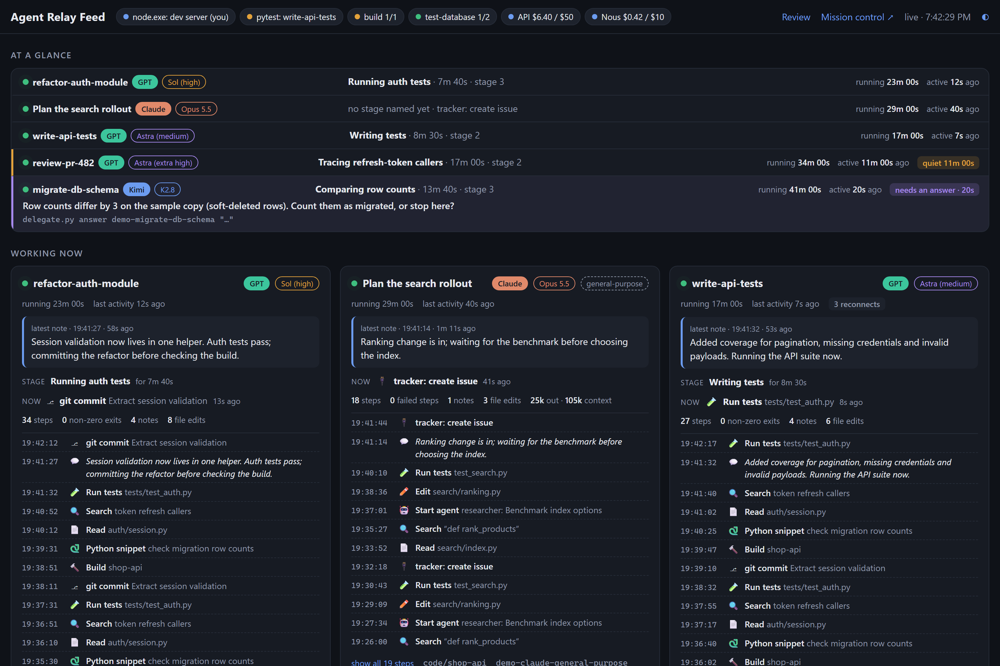
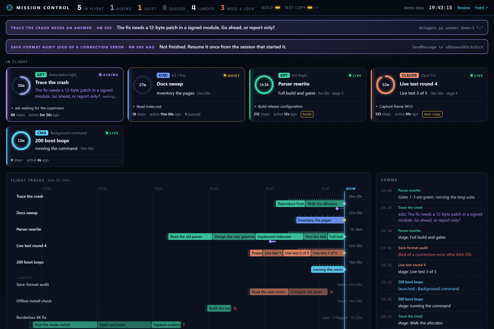

# Agent Relay Feed

Spawn agents and keep an eye on your background tasks in Claude Code.

Run external coding agents from any Claude Code session, or directly from a terminal. A thin relay passes your brief to Codex CLI, Kimi CLI or Claude Code using API credits, waits for the job, and returns its report verbatim. Jobs run in a separate runner process with progress notes, activity logs, resumable sessions, cancellation, and a local read-only feed.

## Requirements

- Python 3.10 or newer; no third-party Python dependencies.
- Claude Code for the relay agents. Direct CLI use does not require Claude Code.
- Claude Code CLI and an owner-provided API key file for the optional `claude-api` backend.
- Codex CLI and/or Kimi CLI installed and logged in, with access to the model IDs you configure. You only need the backend you use. See the [Codex CLI documentation](https://developers.openai.com/codex/cli) for its setup; follow your Kimi CLI distribution's installation and login instructions.

Windows, macOS and Linux are supported by the bridge. Codex sandbox support depends on your platform and CLI version; see [Codex security](https://developers.openai.com/codex/security). This checkout includes model/profile names chosen by its maintainer; they are configuration, not a guarantee of provider availability.

## Install as a plugin

Add this repository as a plugin marketplace, then install the plugin:

```sh
claude plugin marketplace add ChronoRixun/agent-relay-feed
claude plugin install agent-relay-feed@agent-relay-feed
```

From a local checkout instead, run the first command from the folder that contains the checkout and give it a
relative path (absolute Windows paths are rejected by the marketplace command):

```sh
claude plugin marketplace add ./agent-relay-feed
```

For a session-only preview, run `claude --plugin-dir ./agent-relay-feed`.

Start a new Claude Code session after installing. Plugin agents are namespaced,
for example `agent-relay-feed:gpt-sol-high`; manual agents have the unprefixed
names in the table below. You do not need to run the manual installer for the
plugin. Use `/agent-relay-feed:feed` to start the local feed and open its URL, or
ask it to start without opening a browser. `/agent-relay-feed:delegate` describes
profile selection, briefs, waiting, follow-ups and access limits.

The twenty plugin agents are generated from the same template as the manual
installer. They use the documented `${CLAUDE_PLUGIN_ROOT}` substitution in their
Markdown bodies, which resolves to the installed plugin's absolute path. They
resolve your home directory at runtime and store job data outside the plugin
cache, in the existing `~/.claude/delegate/` layout. Plugin updates therefore do
not invalidate hardcoded paths or delete job data. Use a current Claude Code
release with plugin skills and plugin-root substitution in agent content. Older
releases may validate manifests without supporting all runtime behavior; the
manual installer is the fallback. No exact minimum version has been established.

Official references: [plugins overview](https://code.claude.com/docs/en/plugins),
[components](https://code.claude.com/docs/en/plugins/components),
[plugin manifest and path variables](https://code.claude.com/docs/en/plugins-reference#environment-variables),
and [marketplaces](https://code.claude.com/docs/en/plugin-marketplaces).

## Install manually

```sh
git clone <repository-url> agent-relay-feed
cd agent-relay-feed
python install_agents.py
python install_agents.py --list
```

Use `python3` instead of `python` if that is your Python 3 command. The installer records the current Python interpreter and this checkout's absolute location, and writes user-scoped definitions to `~/.claude/agents/`. Keep the checkout in place. Restart Claude Code after installation; user agents are available across projects ([Claude Code subagents](https://code.claude.com/docs/en/sub-agents)).

```sh
python install_agents.py --only gpt-sol-med gpt-sol-high
python install_agents.py --only kimi-k28,kimi-k3
```

All twenty relay variants come from one template:

| Agent tool name | Delegate profile | Effort |
|---|---|---|
| `gpt-astra-med` | `gpt-astra-med` | medium |
| `gpt-astra-high` | `gpt-astra-high` | high |
| `gpt-astra-xhigh` | `gpt-astra-xhigh` | xhigh |
| `gpt-sol-med` | `gpt-sol-med` | medium |
| `gpt-sol-high` | `gpt-sol-med` | high override |
| `gpt-sol-xhigh` | `gpt-sol-med` | xhigh override |
| `gpt-terra-med` | `gpt-terra-med` | medium |
| `gpt-terra-high` | `gpt-terra-high` | high |
| `kimi-k28` | `kimi-k28` | max |
| `kimi-k3` | `kimi-k3` | high |
| `kimi-k31-pro` | `kimi-k31-pro` | max |
| `claude-api-opus` | `claude-api-opus` | high |
| `claude-api-sonnet` | `claude-api-sonnet` | high |
| `claude-api-haiku` | `claude-api-haiku` | medium |
| `nous-deepseek-pro` | `nous-deepseek-pro` | high |
| `nous-deepseek-flash` | `nous-deepseek-flash` | high |
| `nous-mimo-pro` | `nous-mimo-pro` | default |
| `nous-glm` | `nous-glm` | high |
| `nous-glm-flash` | `nous-glm-flash` | high |
| `nous-gemini-argon` | `nous-gemini-argon` | high |

Generated files carry a marker and SHA-256 checksum. Reinstalling updates intact generated files, but preserves modified or unmarked files and returns exit code 1. Review those files before using `--force`. This also means definitions made by an older installer need `--force` to migrate. If you rewrote a relay's `description` (the text Claude Code uses to choose an agent) or its relay `model`, add `--keep-description`: the installer saves those two lines to `~/.claude/delegate/agent-overrides.json` before replacing the file, and this and every later install uses them. After moving the checkout or Python interpreter, rerun the installer.

## Usage in Claude Code

Ask Claude to use the Agent tool with the installed name, for example:

```text
Agent(subagent_type="agent-relay-feed:gpt-sol-high", prompt="Review the parser in the current working directory. Read-only. Return findings with file paths and line numbers.")
```

For a manual install use `gpt-sol-high` instead of the plugin-prefixed name.

Give each relay a self-contained brief: goal, working directory, relevant paths and evidence, permitted changes, constraints, and the final report you want. The relay writes your instructions verbatim into `~/.claude/delegate/inbox/`, starts the job, waits until it ends, and returns the result unchanged. Send follow-ups to the same relay to resume its external session.

## Direct CLI

From the checkout (or use an absolute path to `delegate.py` from another directory):

```sh
python delegate.py profiles
python delegate.py run gpt-astra-high --prompt-file brief.md --cwd /path/to/project --mode read
python delegate.py run gpt-sol-med --effort high --prompt-file brief.md --cwd /path/to/project --mode write
python delegate.py wait <job_id>
python delegate.py status <job_id>
python delegate.py run gpt-sol-med --resume <job_id> --prompt-file followup.md
python delegate.py list
python delegate.py cancel <job_id>
```

On Windows, pass your project directory as `--cwd`; forward slashes are accepted. `run` and `wait` return after at most 540 seconds by default (`--wait SECONDS`). A `STATUS: running` job continues in the background: keep calling `wait`, rather than starting a duplicate. When calling through Claude's Bash tool, give the tool a timeout of 600000 milliseconds. Jobs have a default time limit of 180 minutes (`--max-minutes N`).

`--preamble FILE` prepends a brief or role file and may be repeated. `--add-dir DIR` adds permitted write directories and may be repeated. `--prompt-file -` reads stdin. `--effort VALUE` overrides the profile default. Resume requires a previous job with a session ID and the same backend; it inherits the previous working directory unless `--cwd` overrides it.

Codex is discovered from the Windows desktop install or `codex` on PATH. Set `DELEGATE_CODEX` to the executable path to override discovery. Kimi is discovered from `kimi` on PATH; on Windows the bridge prefers the npm package's `main.mjs` through Node to preserve multiline prompts. `DELEGATE_KIMI_MAIN` overrides that module path. CLI authentication and other settings remain those of your installed tools.

On Windows, sandboxed Codex jobs remove WindowsApps entries from their child PATH to avoid Store shell alias failures. The runner must not stay inside the caller's Windows job object, or tearing down the caller's process tree would kill it; Claude Code's tool processes run in a job that refuses breakaway. So `run` first tries breakaway, then uses WMI (`Win32_Process.Create`) to start the small `detach.py`, which WMI creates hidden in your desktop session but outside the job. It connects back to `run` over an authenticated named pipe, receives the runner's command and the caller's full environment in memory (nothing is written to disk), and starts the runner as its own child, so the runner sees exactly the environment it would have had. `detach_via_wmi: false` turns that off. Only if both fail does the runner start inside the job, and the report warns about it. `detach.txt` in the job folder records which way was used. On macOS/Linux the runner starts a new session. In Codex read mode, progress-file writes may be blocked; activity is still logged.

### Stages, the board and one wake-up per outcome

```sh
python delegate.py board               # one line per running agent: stage, time, last activity
python delegate.py wait --any --wait 43200
```

Every job's prompt asks the worker to run `delegate.py phase "<stage name>"` whenever it starts a new stage. The command itself does nothing: the runner reads the stage name out of the worker's own command stream, so it works in a read-only sandbox and even when the command fails. Stages are kept in the job's `journal.jsonl` beside `started` and the final state, and appear on the feed and in `board`. Claude Code subagents show a stage too if their brief tells them to run the same command.

`board` is the cheap answer to "how is it going?": running relay jobs and Claude Code subagents on one line each, then recent outcomes.

`wait --any` returns when any job ends (done, failed, timeout, cancelled or lost) and prints its report. Each outcome is reported once: a job whose result was already shown by `run`, `wait` or `status` is not reported again, and jobs that ended between two calls are picked up by the next one. A supervising session can therefore start jobs with `run ... --wait 0` and keep a single background `wait --any` as its only wake-up. It covers relay jobs only; Claude Code reports its own subagents.

### Queues and automatic resume

```sh
python delegate.py run gpt-sol-med --prompt-file next.md --cwd /work/repo --after <job_id> --wait 0
python delegate.py run gpt-terra-high --prompt-file gates.md --after <job_id> --after agent-<id> --after-ok --wait 0
```

`--after` creates the job but holds it as `queued` until every job it names has ended; it then starts on its own. A dependency is a relay job id, or `agent-<id>` (as shown on the feed) for a Claude Code subagent. With `--after-ok` the job starts only if they all ended successfully (done, and not a `fail` or `blocked` verdict); otherwise it is cancelled with the reason, and an alert is sent. Queued jobs are stored on disk like any other job, so the plan survives the supervising session losing its memory: `board` lists them with what they wait for, and `cancel <job_id>` removes one. They are released when a relay job ends and by a running `wait --any`, and no more than `queue_max_running` relay jobs (default 3) run at once. A job queued behind a Claude Code subagent is released only while a `wait --any` is running, since nothing else is watching.

A relay job that fails with a connection error (a dropped stream, a certificate or network error, a 502/503/504) is resumed once automatically, as a new job on the same session with the same name; the failed job's report says `AUTO-RESUMED AS` and jobs queued behind it wait for the resumed one. `auto_resume` sets how many times (default 1, `0` turns it off). Claude API jobs are never resumed this way, because each of their runs needs its own approval, and Claude Code subagents cannot be resumed from outside.

### Time limits, guard flags, spend and the digest

**Wrap-up warning.** `checkpoint_minutes` (default 10) before a job's `--max-minutes` limit, its runner tells the worker to stop starting new work, save or commit what it has, release its slots and write its report. Workers read messages when they change stage, so if the warning is still unread at the limit the job gets one more window of the same length before it is stopped. `0` turns the warning off. (Claude API jobs keep the plain limit.)

**Yield.** While a worker holds a slot on a resource with `yield_to` programs and the machine's owner starts one, the runner tells the worker once to stop using it and release it. Like every message, it lands at the worker's next stage change.

**Guard flags.** When a job ends, its activity log is scanned for things that usually need the owner's say-so: software installs (`pip install`, `npm install -g`, `winget install`, ...), commands that publish (`git push`, `gh release|pr|issue create`, ...), and file changes in a read-only job. Each becomes a flag beside the verdict, with an example command. It reports after the fact and cannot stop anything, and a brief may have allowed it, so a flag means "check", not "wrong". `guard_patterns` adds rules; `guard_enabled: false` turns it off.

**Spend.** `board`, the feed and mission control show the Claude API spend recorded this calendar month, against `claude_api_monthly_usd` if you set one. Other providers' quotas are not visible to this tool.

**Digest.** `python delegate.py digest --hours 12` prints what finished while you were away, sorted into what is waiting for an answer, what needs a look (failed or flagged), what is yours to do, and what was left open; `--send` also pushes it through your alerts. Schedule it with your operating system's task scheduler for a morning summary.

**Hard to miss.** The feed and mission-control pages put the number of waiting questions in the browser tab's title and play a short chime when a new one arrives (browsers allow the sound only after you have clicked the page once).

### Talking to a running job

```sh
python delegate.py tell <job_id> "1080 spills too; windowed as well"
python delegate.py answer <job_id> "Yes, use the visible desktop"
```

`tell` queues a message for a running job. The worker reads it the next time it names a stage (the `phase` command prints waiting messages), so delivery is at its next stage change, not instant. `board` shows how many messages are still unread.

A worker that reaches a decision it should not make alone runs `delegate.py ask --job <id> "<question>"`, which waits for the reply. The question appears on the feed and in `board`, and `wait --any` returns with it (once per question) and the `answer` command to use. `answer` lets the worker continue with your reply; the job is not ended and not restarted. One `ask` waits `ask_wait_seconds` (default 240) and then tells the worker to run it again, so the wait survives the agent's own command time limit. Time spent waiting for an answer does not count against `--max-minutes` (Codex and Kimi jobs).

Workers in a read-only sandbox cannot record which messages they have seen, so they are shown every message each time; elsewhere only new ones are shown. All of this applies to relay jobs: Claude Code subagents are messaged with Claude Code's own tools.

### Answering from the feed, and alerts

Set `feed_pin` (four characters or more) and the feed and mission-control pages gain an answer box on every waiting question and a message box on every running relay job. The page asks for the PIN once and remembers it in that browser. The PIN allows exactly two things, `answer` and `tell`; it cannot start, cancel or change jobs. Five wrong PINs from one address lock that address out for five minutes. Without `feed_pin` the feed stays read-only. The feed speaks plain HTTP, so anyone who can watch your network traffic can read the PIN: use it on a network you trust, and do not reuse a password.

`notify` sends an alert when a relay job asks a question or ends:

```json
"notify": [{"kind": "ntfy", "url": "https://ntfy.sh/<a-long-private-topic-name>"}],
"notify_on": ["question", "failed", "flagged"],
"notify_link": "http://192.168.1.20:8765/mission"
```

`kind` is `ntfy` (an [ntfy](https://ntfy.sh) topic), `discord` (a Discord webhook URL) or `json` (a POST of `{"event", "title", "body", "link"}` to any URL). Events are `question`, `failed` (failed, timed out, lost, or a fail/blocked verdict), `flagged` (done, but claims did not check out) and `done`. Alerts for relay jobs are sent by each job's own runner, so they do not need the feed to be running. Claude Code subagents have no runner: while the feed server is running it sends an alert when a subagent it saw working finishes. An alert carries the job's name and the question or result summary to the service you chose; set `notify_detail` to `false` to send only the job's name and the kind of event. `notify_link` is the address the alert opens.

Give jobs a readable title with `run ... --name "Trace the crash"`; it is what the board, the feed and alerts show.

### Structured results and checked claims

Every job is asked to end its final report with a fenced `result` block: a verdict (`pass`, `fail`, `partial`, `blocked`), a one-line summary, commits (repo, branch, head), uncommitted files, checks with their results, evidence files, open items, cleanup, and items for the owner. When the job ends the runner reads that block and checks what a machine can check: each commit exists and its branch points at it, the repo has no uncommitted changes, each file and evidence file exists, is not empty and is not older than the job, an image is the pixel size it is said to be, and a `pass` verdict is not contradicted by a failed check or an open item.

`wait`, `wait --any` and `status` print this first, before the full report:

```
VERDICT: pass  |  CLAIMS CHECKED: 6 ok, 1 FLAGGED
SUMMARY: Borderless 4K fix on fix/borderless, gates green.
  FLAG: image is 1920x1080, NOT the claimed 3840x2160: /work/shots/menu.png
  COMMIT: 3f2a9c1d07 on fix/borderless in /work/repo
  CHECKS: unit=pass (214 passed); live 4K=pass
  YOUR TURN: push the branch
```

`board` and the feed show the verdict and the number of flagged claims beside each finished job. The block and findings are kept in the job folder as `result.json`. These checks catch missing, stale and mismatched things; they cannot tell whether a screenshot shows the right window or whether a test was honest, so an unflagged result still deserves a look at its evidence. A report with no block is shown as before, marked as having no verdict.

### Slots for shared resources

On a machine that several agents and its owner share, the `resources` config key names what must not be used at the same time:

```json
"resources": {
  "build":     {"slots": 1, "rule": "any compiler or full test-suite run"},
  "test-copy": {"slots": 2, "values": ["/work/copy-1", "/work/copy-2"],
                "yield_to": ["TheApp.exe"], "rule": "launching the application under test"}
}
```

Every job's prompt then lists these with their rules and tells the worker to run `delegate.py lease --job <id> <name>` before such work and `release` afterwards. `lease` waits for a free slot and prints `GRANTED` (with the slot's value, such as the folder to use) or `NOT YET` with the reason. Slots a job still holds are freed when it ends, and a holder that died loses its slots. While a program listed in `yield_to` is running and is not an agent's own (as the feed's process watcher judges it), nobody new is granted that resource. Anything outside a relay job, such as a Claude Code subagent, takes part with `lease --as <name> <resource>`; those slots expire after three hours unless leased again.

```sh
python delegate.py slots          # who holds what; also shown by `board` and on the feed
python delegate.py release --job <job_id> build     # take a slot back by hand
```

This is cooperative: it tells workers when they may go ahead and gives each its own slot, but it cannot stop a worker that ignores its instructions, and a slot that is already held is not taken away when the owner starts one of the `yield_to` programs.

### Long commands: `bg`

An agent that must run something for a long time (a boot loop, a bulk delete, a soak test) should not keep a background shell and wake up to check it. `bg` runs the command as a job of its own:

```sh
python delegate.py bg --name "200 boot loops" --lease test-copy --lease build -- python boot_loop.py --n 200 --copy {test-copy}
python delegate.py bg --shell powershell -- "Get-ChildItem big | Remove-Item -Recurse"    # pipes need a shell
```

The command starts detached like any job's runner, so it outlives the agent's session. It takes the slots named with `--lease` before it starts and holds them until it ends; `{name}` in the command is replaced by that slot's value (or its number), and `DELEGATE_SLOT_<NAME>` and `DELEGATE_JOB` are set in its environment. All output goes to `output.log` in the job folder, the newest lines show as activity on the feed, and the job ends as `done` (exit code 0) or `failed`, with the exit code and the last 40 lines of output as its result. It is on `board`, the feed and mission control, `cancel` stops it, `--max-minutes` (default 600) limits it, and `wait --any` reports it exactly once. An agent that needs the result runs `wait <job_id>` in the foreground; one that does not simply ends its turn.

### Screenshots with a record: `capture`

The claim checks can tell that an image exists and has the stated size, not what it is a picture of. `capture` (Windows) closes most of that gap:

```sh
python delegate.py capture D:/work/menu.png --process TheApp.exe    # or --window "<title text>", --pid <n>, --foreground
python delegate.py capture --list                                   # the windows it can see
```

It saves the client area of that program's window and writes `menu.png.capture.json` beside it: window title, program, real pixel size, whether the window had a border, the monitor's size and whether the window fills it, whether it was in front, and a hash of the image. It never activates or moves the window: a window that is in front is copied off the screen, a covered one is asked to draw itself, and if one way gives a flat colour the other is tried. A program that ignores Windows display scaling is captured at the size it actually renders, and the stretched on-screen size is recorded. An evidence entry may then say `"process": "TheApp.exe"`, `"window": "<title text>"`, `"borderless": true` or `"fullscreen": true`; the result checks compare those (and the word "borderless" in `shows`) with the record and flag a picture of another program or window, a window that had a border, a blank capture, and an image that was cropped or edited after capture. A `process` or `borderless` claim on an image with no record is flagged as uncheckable. Unflagged screenshots are listed in the result summary as `SCREENSHOT: captured from ...`, and the Review page shows the same line under each image. Some programs draw nothing into a background capture; the helper says so instead of saving a wrong picture as proof.

### Writing a file when the Write tool is refused: `save`

`python delegate.py save <path>` writes whatever is piped into it (parent folders are created; `--force` replaces an existing file, `--append` adds to it). `save <path> --from <job_id or agent-id>` writes that finished job's or Claude Code subagent's final message, so a report that only exists in a final message can be put on disk without any quoting.

## Models from Nous Portal

[Nous Portal](https://portal.nousresearch.com/models) sells access to many model families through one OpenAI-compatible API, billed to Nous credits. Six of them are profiles here, each run by the Kimi CLI:

| Profile | Model | Suited to |
|---|---|---|
| `nous-deepseek-pro` | DeepSeek V4 Pro | implementation, scripts, second opinions |
| `nous-deepseek-flash` | DeepSeek V4.1 Flash | cheap bulk and routine work |
| `nous-mimo-pro` | Xiaomi MiMo V2.6 Pro | long investigations (cached input is nearly free) |
| `nous-glm` | Z.ai GLM 5.3 | long-horizon coding, a different-family opinion |
| `nous-glm-flash` | Z.ai GLM 5.3 Flash | cheap routine coding and chores |
| `nous-gemini-argon` | Google Gemini 4 Argon | reviews of plans, diffs and conclusions (the expensive tier) |

Put your Nous API key alone in `~/.claude/delegate/nous-api-key.txt` (`nous_api_key_file`). Each job gets its own Kimi home folder inside its job folder whose `config.toml` names Nous Portal as a provider and reads the key from the `NOUS_API_KEY` environment variable; the runner sets that variable for the CLI process only, so the key is never written into the CLI's config, the job folder or a log, and your own Kimi setup is not touched. Follow-ups (`--resume`) continue in the same Kimi home.

Spend is measured, not guessed: the Kimi CLI records the tokens of every model call in its session files, and the runner prices them with the Portal's live per-token prices (read from its public model list when the job starts, including the cheaper cached-input price). It checks every 5 seconds and stops the job when it passes its cap, which is `nous_max_usd_per_job` (default $3) unless `--max-usd` sets another; a job can end slightly over the cap by the cost of its last model call. Finished jobs go into `nous-ledger.jsonl`, `board`, the feed and the digest show the month's total, and with `nous_monthly_usd` set, `run` refuses new Nous jobs once the month's spend reaches it. Like the other Kimi profiles, these run without a sandbox: `read` and `write` are instructions, not enforced limits.

## Claude via prepaid API credits

Install Claude Code, create an API key in the [Claude Console](https://platform.claude.com/settings/keys),
and set a workspace spend limit there. Save only the key on one line to
`~/.claude/delegate/anthropic-api-key.txt` (Windows: `%USERPROFILE%/.claude/delegate/anthropic-api-key.txt`).
Restrict access to the file. The relay never creates it; `claude_api_key_file` in
local config overrides its path. `DELEGATE_CLAUDE` selects the CLI executable.

The owner must approve **each specific run, including follow-ups**. Relay agents
copy that approval note into `--approved`; they must never invent approval.

```sh
python delegate.py run claude-api-sonnet --prompt-file brief.md --cwd /path/to/project --mode write --approved "Sam / 2026-10-13 / implement parser" --max-usd 2
python delegate.py spend -n 5
```

Profiles use `claude-opus-5-5`, `claude-sonnet-5-5`, and `claude-haiku-5-5`.
Model availability and effort support depend on the installed CLI and account.
Effort uses `CLAUDE_CODE_EFFORT_LEVEL`; older CLIs may ignore it.
The key is read from the file and put only in the child environment. Missing or
empty files refuse the run with no subscription fallback. The runner strips
alternative credentials, cloud-provider routing and custom API endpoints, uses
`~/.claude/delegate/claude-api-home` for isolated settings/session history,
disables user/project/local settings and hooks, and requires the init event's
`apiKeySource` to equal `ANTHROPIC_API_KEY`. A different or missing source stops
the child. Never sign in to that isolated home or place secrets there. Managed
machine policies can still apply. See [authentication](https://code.claude.com/docs/en/authentication)
and the [CLI reference](https://code.claude.com/docs/en/cli-reference).

`read` maps to plan mode, `write` to acceptEdits for cwd and authorized `--add-dir`
folders, and `full` to bypassPermissions. These are tool permissions, not an OS
sandbox; headless shell commands needing approval may be denied. MCP is empty
by default with `--strict-mcp-config`. To load a server named `docs`, set `claude_api_mcp_allow`
to `["docs"]` and provide its Claude MCP definition in `claude_api_mcp_servers.docs`.
No MCP servers or credentials are copied from the owner's Claude settings.

`--max-usd` passes Claude's `--max-budget-usd` and stops the child when a reported
`total_cost_usd` exceeds the cap. Cost is generally reported at the final result;
checks cannot prevent an in-flight request from overshooting. Interrupted jobs
may have unknown/partial spend. Console billing is authoritative. Feed cards,
status and reports show reported cost. Each finished job appends one line to
`~/.claude/delegate/claude-api-ledger.jsonl`: job, approval, model, start/end,
status, cost and token usage. `spend` totals known costs and counts unknown costs.
Child stdout/stderr is redacted before relay storage. Tests make no real API calls.

## Feed and watch

```sh
python feed.py
python feed.py --open
python feed.py --port 9000 --hours 24
python feed.py --dump --hours 1
python delegate.py watch
python delegate.py watch <job_id> --stall 10 --loop 6 --no-color
```

The feed binds to `127.0.0.1:8765` by default. Open that URL in your browser, or use `--open` to open your default browser. To read it from another computer or a phone on the same network, start it with `--host 0.0.0.0` (or set `feed_host`); the feed has no login, so do this only on a network you trust. It shows an at-a-glance row per running agent (stage, time in stage, running time, last activity), running cards and jobs finished in the last 12 hours (`--hours N`). Hover steps for the recorded command; expand cards for the timeline, progress notes and result. `--dump` prints the same snapshot as JSON without starting a server or opening a browser, even with `--open`. The terminal watch follows running and newly started jobs; supply job IDs to follow only those jobs.

Use `python feed.py --demo` (optionally `--port N`) to preview invented jobs, stages, a question, slots and processes without reading your job data. The demo never touches real jobs: answering is off, the Review page is empty, and queued jobs and alerts are left alone. `/mission?demo` shows mission control with its own invented data on any running feed.

Badges and indicators:

- Green dot: a running job.
- Model chip: model label with the effort actually used; Kimi keeps its profile label.
- Read-only / full-access chip: selected execution mode; write is the default.
- Quiet: no activity or recent working-directory file writes for the stall threshold. A long operation may still be healthy.
- Possible loop: the same recorded command repeated at least six times in the last ten commands. Repeats averaging 30 seconds apart or more count as polling and suppress this warning.
- Reconnects: connection retry messages observed in the log.
- Errors / non-zero exits: recorded errors or failed command exits, which may be recoverable.
- Finished icon: done, failed, timeout, cancelled or lost (runner missing without a final status).
- Optional process pills: watched executable, matching job or configured owner; unknown means attribution failed. Green means no watched process was found, not that the whole computer is idle.

### Mission control

`/mission` on the feed server is a second view of the same data, built for a glance from across the room: a tile per running agent (stage, a ring that drains as the agent goes quiet, the step it is on, slots it holds), a timeline with one track per agent showing each stage it named, questions and their answers, recent steps and how finished jobs ended, and a running log of stage changes, questions and outcomes across all agents. A waiting question is shown as a banner. Open `/mission?demo` to see it with made-up data.

### Review page (evidence gallery)

`/evidence` on the feed server shows every file that recently finished jobs cite as evidence in their result blocks, grouped by job: each image beside the claim it is meant to prove, with its real pixel size (in red if it differs from the claimed size), a warning if the file is missing or older than the job, and the file's path. Jobs that need a look (failed, a verdict other than a clean pass, or flagged claims) are listed too even when they cite no evidence, with the flagged claims spelled out, and come first. **Mark reviewed** (it needs `feed_pin`) records that you have dealt with a job: it stops counting under *need a look* on mission control and in `digest`, on every device. `python delegate.py reviewed <job_id>` does the same from a terminal, and `--undo` takes it back. Click an image to see it full screen at fit or actual size; any item can be marked as looked at in that browser. Non-image evidence is shown as the start of the file. The automatic checks can say that a screenshot exists and has the claimed size; only looking at it tells you whether it shows the right thing, and this page is for that. Files are served only if a job's result block names them; like the rest of the feed the page has no login, so anyone who can reach the feed can see them. A Claude Code subagent is listed too if its final message ends with a result block (`python delegate.py result-format` prints the format to put in its brief).

### Claude Code subagents

The feed and `watch` also show native Claude Code subagents: agents started with the Agent tool, including nested ones and custom agent types. Claude Code writes each subagent's transcript to `~/.claude/projects/<project>/<session>/subagents/agent-<id>.jsonl`, next to an `agent-<id>.meta.json` with its description, agent type and nesting depth. The feed reads transcripts changed in the last 24 hours, tailing each file from where it left off, and never writes to them.

- Card: a "Claude" badge, the model (for example "Opus 5.5") and the agent type; the title is the description given when the agent was spawned. Nested agents name the agent that started them.
- Steps: one line per tool call, in the same words as relay jobs (commands, Read/Edit/Write with file names, searches, agent spawns, MCP tool names). The card also shows the agent's own short text lines and its output token count. Prompts, file contents and tool output are never shown.
- Status: running while the agent's turn is open; done once its last message ended the turn with no tool call pending and the transcript stayed quiet for a few seconds; failed when that last message is an API error; cancelled when Claude Code records that you stopped it; lost when an open turn has been silent for an hour (the session ended under it). Quiet and possible-loop warnings follow the same rules as relay jobs.
- Finished subagents list the first lines of their final message.
- Cut off by the connection: a subagent whose last message is a connection, certificate or overload error did not finish, and only the session that started it can resume it. It is shown as **died**: `board` lists it with the step that resumes it (`SendMessage` to its agent id), `wait --any` reports it once, the feed and mission control show it, and an alert is sent. `python delegate.py reviewed agent-<id>` clears it once handled. `wait --any` also keeps waiting while subagents run.
- Ids: `board` shows a subagent as `agent-<id> (type)`. `reviewed` and `run --after` take that id, the bare id or its first characters, or the short `type#<last four>` label.
- Subagents whose type is one of this tool's relays are left out: the relay job's own card already shows that work.
- `watch` prints a line when a subagent starts, finishes, goes quiet or seems to loop. It follows subagents only when no job IDs are given.

Set `claude_agents_enabled` to `false` to turn this off (see the config table below).

The process panel is hidden without configuration. Process discovery uses PowerShell/CIM on Windows and `ps` on macOS/Linux, with `/proc` executable paths when available on Linux. Missing tools, permission restrictions and unavailable paths make discovery or ownership best effort. It never launches or stops watched processes.





Both screenshots show invented demo jobs.

## Optional local config

Create `~/.claude/delegate/config.json` yourself. No config is needed. The bridge never creates or overwrites it. Settings are loaded when each CLI/feed process starts; restart the feed after editing. Invalid JSON or invalid fields produce a warning and retain defaults.

Generic example (adapt the paths and executable names):

```json
{
  "path_shortening": [["/work/tasks", "tasks/"], ["/work", "W/"]],
  "watched_processes": [
    {
      "name": "editor.exe",
      "owner": "unknown",
      "owners": [{"path_patterns": ["/personal/editor"], "owner": "you"}]
    }
  ],
  "feed_port": 8765,
  "stall_seconds": 480,
  "loop_count": 6,
  "polling_seconds": 30,
  "job_path_roots": ["/work/tasks"],
  "activity_ignore_paths": ["/work/tasks"],
  "claude_agents_enabled": true,
  "claude_agents_window_hours": 24,
  "claude_agents_projects": []
}
```

| Key | Default | Meaning |
|---|---|---|
| `path_shortening` | `[]` | Pairs of path prefix and display replacement; longest prefix wins, either slash style is accepted. Home always shortens to `~`. |
| `watched_processes` | `[]` | Executable names matched without case sensitivity; an empty list hides the panel. |
| `feed_port` | `8765` | HTTP port (1–65535); `--port` overrides it. |
| `feed_pin` | `""` | PIN that lets the feed pages answer questions and message jobs; empty keeps the feed read-only. |
| `notify` | `[]` | Where to send alerts: a list of `{"kind": "ntfy" \| "discord" \| "json", "url": "..."}`. Empty = no alerts. |
| `notify_on` | all four | Which events alert: `question`, `failed`, `flagged`, `done`. |
| `notify_detail` | `true` | `false` sends only the job's name and the kind of event. |
| `notify_link` | `""` | Address an alert opens, such as your feed's `/mission` page. |
| `resources` | `{}` | Shared resources and their slots; see "Slots for shared resources". |
| `codex_exec_yield_ms` | `0` | Milliseconds a Codex script may run before handing back to the model unasked (Codex's default is 30000); `0` leaves it alone. A larger value saves model requests while a worker waits. |
| `codex_mcp_allow` | `[]` | MCP server names from your Codex config that relay jobs may load; every other server is switched off. Add `codex_apps` to keep ChatGPT app connectors. |
| `codex_plugins_allow` | `[]` | Codex plugin names (as written in your Codex config, for example `name@source`) that relay jobs may load; every other plugin is switched off. |
| `checkpoint_minutes` | `10` | Minutes before a job's time limit at which the worker is told to wrap up; `0` = no warning. |
| `guard_enabled` | `true` | Flag installs, publishing commands and read-only violations when a job ends. |
| `guard_patterns` | `[]` | Extra guard rules: `[{"pattern": "<regex>", "text": "<what it means>"}]`. |
| `claude_api_monthly_usd` | `0` | Monthly Claude API budget shown beside the month's spend; `0` = no budget. |
| `nous_api_key_file` | `~/.claude/delegate/nous-api-key.txt` | File holding only your Nous Portal API key. |
| `nous_max_usd_per_job` | `3.0` | Spend cap of one Nous job unless `run --max-usd` sets another; `0` = no cap. |
| `nous_monthly_usd` | `0` | Nous Portal budget for the calendar month; new Nous jobs are refused once it is reached. `0` = no budget. |
| `queue_max_running` | `3` | Queued jobs start only while fewer relay jobs than this are running. |
| `auto_resume` | `1` | How many times a job that died of a connection error is resumed automatically; `0` = never. |
| `ask_wait_seconds` | `240` | How long one worker `ask` command waits for an answer before telling the worker to run it again. Keep it under the longest time the agent's shell tool lets one command run. |
| `feed_host` | `"127.0.0.1"` | Address the feed listens on; `--host` overrides it. `"0.0.0.0"` shows the read-only feed, with no login, to every device on the local network. |
| `stall_seconds` | `480` | Activity silence threshold; watch's `--stall` overrides it in minutes. |
| `loop_count` | `6` | Repetition threshold in the last ten commands (2–10); watch's `--loop` overrides it. |
| `polling_seconds` | `30` | Minimum average interval that treats repetitions as polling. |
| `job_path_roots` | `[]` | Optional shared work roots: the first folder below a root is matched to a job's working-directory components. |
| `activity_ignore_paths` | `[]` | Exact shared directories to exclude from activity scans and broad process ownership matches. |
| `claude_api_key_file` | `~/.claude/delegate/anthropic-api-key.txt` | API key file; missing/empty refuses the run. |
| `claude_api_mcp_allow` | `[]` | Explicit Claude API MCP server names, e.g. `["docs"]`. |
| `claude_api_mcp_servers` | `{}` | Claude MCP definitions by name; only allowlisted entries load. |
| `claude_agents_enabled` | `true` | Show native Claude Code subagents in the feed and `watch`. |
| `claude_projects_root` | `~/.claude/projects` | Where Claude Code keeps session transcripts. |
| `claude_agents_window_hours` | `24` | Only subagent transcripts changed within this many hours are read. |
| `claude_agents_projects` | `[]` | Optional substrings; when set, only subagents whose project folder or working directory contains one are shown (case and slash style ignored). |

Each watched-process entry has `name`, optional fallback `owner`, and optional `owners`: an ordered list of `{path_patterns: [...], owner: "label"}` rules. Path patterns are literal substrings, with case and slash style ignored. A process inside a running job's working directory is attributed to that job first (longest directory wins), then shared-root matching applies. Optional `job_cwd_patterns: [...]` matches literal substrings in running job directories when an executable lives elsewhere; use only when that association is intentional. Then the first matching owner rule wins, followed by the fallback owner (`unknown` by default).

## Profiles

Edit `PROFILES` near the top of `delegate.py` to change provider model IDs or add a direct-CLI profile. Each entry needs `backend` (`codex`, `kimi` or `claude-api`), `model`, `effort` and a display `label`. For example:

```python
"reviewer": dict(backend="codex", model="your-model-id", effort="high", label="Reviewer (high)")
```

To expose it as a relay in Claude Code, add `dict(name="reviewer", profile="reviewer")` to `install_agents.py`'s `SPECS`, then rerun the installer. For the plugin, run `python build_plugin.py` and include the regenerated `agents/` files. A spec may set `effort` to use one profile with a different effort, as `gpt-sol-high` does. Model IDs and supported effort values depend on your backend/account; the bridge passes them through.

## Safety

`~/.claude/delegate/agents/<profile>/` contains `progress/<job_id>.md`, `activity/<job_id>.log`, `reports/<job_id>.md` and `latest-report.md`. `~/.claude/delegate/jobs/<job_id>/` contains the prompt, metadata, command, events, stderr, result and status. The high-effort Sol relay uses the `gpt-sol-med` folder because that is its delegate profile. `DELEGATE_JOBS_DIR` and `DELEGATE_AGENTS_DIR` can override the two storage roots.

- Codex `read`: read-only sandbox. Codex `write`: workspace-write sandbox for the working directory, extra directories and progress folder, with network enabled. Codex `full`: bypasses sandbox and approval prompts; use only when explicitly authorized.
- Kimi's prompt mode runs without approvals or sandbox enforcement. Its `read` and `write` modes are instructions in the brief, not filesystem protection.
- Every brief instructs the worker not to commit, push, publish, send, launch games or drive the desktop unless the brief explicitly requests it. These instructions are not a network security boundary. Always state your constraints and review the returned work.
- Codex relay jobs do not inherit your Codex tools: every MCP server and plugin in your Codex config (`$CODEX_HOME/config.toml`, default `~/.codex/config.toml`) is switched off for the job with `-c <kind>.<name>.enabled=false`, and ChatGPT app connectors with `-c features.apps=false`, unless the name is listed in `codex_mcp_allow` / `codex_plugins_allow`. This keeps a background agent away from desktop control, messaging and account tools you use interactively. Names containing a dot cannot be addressed by `codex -c` and stay as configured. Kimi jobs are unaffected.
- Relays return reports without checking the worker's claims. CLI calls may consume provider quota or incur costs under your account.
- Logs and briefs may contain sensitive project data. The feed is local and read-only, but anyone able to access its port can read the displayed data: with `feed_host` set to `0.0.0.0` that is everyone on your network. Do not expose it publicly or commit job logs.

## Uninstall

For a plugin install:

```sh
claude plugin uninstall agent-relay-feed@agent-relay-feed
claude plugin marketplace remove agent-relay-feed
```

Stop any running feed background task separately. Plugin uninstall leaves this
tool's job history and local config in `~/.claude/delegate/`; archive or remove
those yourself when you no longer need them. It does not remove manually
installed relays or external CLIs. For a manual install:

```sh
python install_agents.py --uninstall
python install_agents.py --uninstall --only kimi-k28 kimi-k3
```

Uninstall removes intact generated relay definitions only. Modified/unmarked files require explicit `--force`. Job history, config and the checkout remain; archive or remove them yourself after cancelling any running jobs. The installer does not uninstall external CLIs.

## Development and validation

```sh
python -m unittest
python build_plugin.py --check
claude plugin validate .claude-plugin/plugin.json
claude plugin validate .claude-plugin/marketplace.json
```

`build_plugin.py --check` detects missing, stale and unexpected generated agent
files. Manifest validation checks packaging, not provider login/model access or
runtime path expansion. Before publishing, load the plugin in a current Claude
Code session and smoke-test one authorized read-only task and the feed command.

Tests use only the standard library and temporary directories inside the checkout. The source filenames and `~/.claude/delegate/` storage layout remain unchanged for compatibility.

## License

Licensed under [Apache License 2.0](LICENSE). See [NOTICE](NOTICE) for attribution. Copyright 2026 ChronoRixun.
