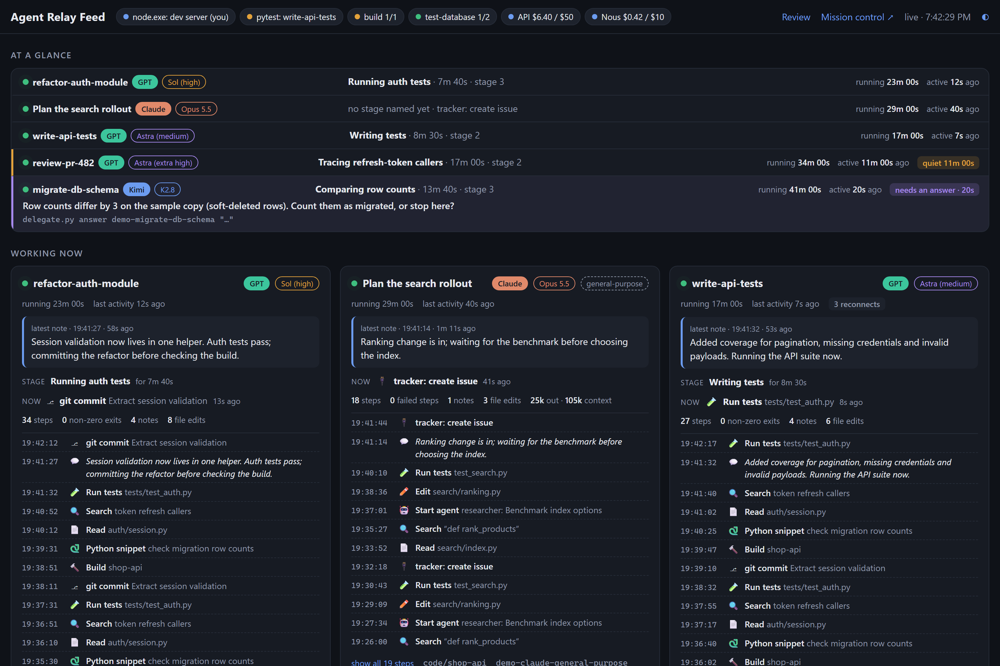
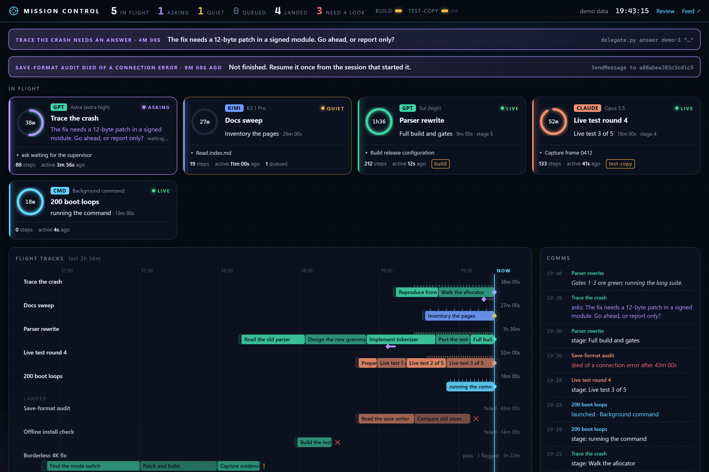
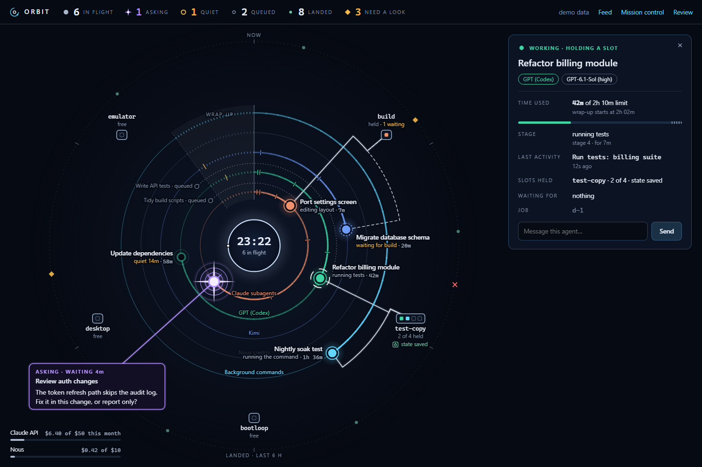

# The feed and its pages

[Back to the README](../README.md)

```sh
python feed.py
python feed.py --open
python feed.py --port 9000 --hours 24
python feed.py --dump --hours 1
python feed.py --demo
```

The feed binds to `127.0.0.1:8765` by default. Open that URL in your browser, or use `--open` to open your default
browser. To read it from another computer or a phone on the same network, start it with `--host 0.0.0.0` (or set
`feed_host`); the feed has no login, so do this only on a network you trust. `--dump` prints the same snapshot as JSON
without starting a server or opening a browser, even with `--open`. In Claude Code, `/agent-relay-feed:feed` starts it
for you. Settings are read when the feed starts, so restart it after changing the config or updating the code.

The same server has four pages:

| Page | For |
|---|---|
| `/` | The feed: one card per agent, with its steps, timeline, notes and result |
| `/mission` | Mission control: tiles, timelines and a log, for a glance from across the room |
| `/orbit` | Orbit: the whole machine on one dial, for a second screen or a phone |
| `/evidence` | Review: files that finished jobs cite as proof, beside their claims |

## The feed



It shows an at-a-glance row per running agent (stage, time in stage, running time, last activity), running cards and
jobs finished in the last 12 hours (`--hours N`). Hover steps for the recorded command; expand cards for the timeline,
progress notes and result.

Badges and indicators:

- Green dot: a running job.
- Model chip: model label with the effort actually used; Kimi keeps its profile label.
- Read-only / full-access chip: selected execution mode; write is the default.
- Quiet: no activity or recent working-directory file writes for the stall threshold. A long operation may still be
  healthy.
- Possible loop: the same recorded command repeated at least six times in the last ten commands. Repeats averaging 30
  seconds apart or more count as polling and suppress this warning.
- Reconnects: connection retry messages observed in the log.
- Errors / non-zero exits: recorded errors or failed command exits, which may be recoverable.
- Finished icon: done, failed, timeout, cancelled or lost (runner missing without a final status).
- Slot pills: each shared resource with how many of its slots are held, and how many agents are waiting.
- Optional process pills: watched executable, matching job or configured owner; unknown means attribution failed.
  Green means no watched process was found, not that the whole computer is idle.

The process panel is hidden without configuration (`watched_processes` in [CONFIG](CONFIG.md)). Process discovery uses
PowerShell/CIM on Windows and `ps` on macOS/Linux, with `/proc` executable paths when available on Linux. Missing tools,
permission restrictions and unavailable paths make discovery or ownership best effort. It never launches or stops
watched processes.

## Mission control



A second view of the same data: a tile per running agent (stage, a ring that drains as the agent goes quiet, the step
it is on, slots it holds), a timeline with one track per agent showing each stage it named, questions and their
answers, recent steps and how finished jobs ended, and a running log of stage changes, questions and outcomes across
all agents. A waiting question is shown as a banner.

## Orbit



The same data as an orrery. One rule holds for the whole picture: clockwise from 12 o'clock means time passed.

- **The centre is this machine**: the clock and how many agents are in flight. When its owner runs a program that
  agents give way to (a resource's `yield_to`), the centre turns amber and names it, the closed stations are marked,
  and a waiting beam stops at a stop bar.
- **Rings are who does the work**: Claude Code subagents, Codex, Kimi, Nous credits, Claude API credits when used, and
  background commands.
- **Planets are running agents.** One lap is the job's time limit (an hour for subagents, which have none), so the trail
  behind a planet is how much of its time it has used; the shaded wedge before the start line is where wrap-up warnings
  begin, and small notches on a trail are the stages the agent named. A solid disc is working, a hollow dimmed one is
  quiet, a broken red ring was cut off by a connection error and waits to be resumed.
- **An agent that asks a question** becomes a flare with a line to a box that holds the question, so it is the first
  thing seen.
- **Stations are the shared resources** with one square per slot. A solid beam joins an agent to a slot it holds, a
  dashed one to a slot it is waiting for; beams run out from the planet and round a lane, never across the centre. A
  small vault mark means that resource's shared state is saved.
- **The outer belt holds finished jobs** of the last six hours by how long ago they ended: a dot passed, a diamond
  needs a look, a cross failed.
- **Pulses**: when an agent runs something, a short comet falls from its planet into the centre (or along its beam, if
  it holds a slot); a new stage adds a ripple.

Clicking a planet, a queued job or a belt marker opens a card with its stage, time used against its limit, last
activity and slots; with `feed_pin` set, the card can answer a question or send a message. On a narrow screen the labels
are dropped and the questions, spend and a list of agents sit under the orrery. It honours the system's reduced-motion
setting. With many agents, labels are dropped and a name shows for the planet the pointer is on.

## Review page

It shows every file that recently finished jobs cite as evidence in their result blocks, grouped by job: each image
beside the claim it is meant to prove, with its real pixel size (in red if it differs from the claimed size), a warning
if the file is missing or older than the job, and the file's path. Jobs that need a look (failed, a verdict other than a
clean pass, or flagged claims) are listed too even when they cite no evidence, with the flagged claims spelled out, and
come first. Screenshots taken with `capture` show what they were captured from.

**Mark reviewed** (it needs `feed_pin`) records that you have dealt with a job: it stops counting under *need a look* on
mission control and in `digest`, on every device. `python delegate.py reviewed <job_id>` does the same from a terminal,
and `--undo` takes it back. Click an image to see it full screen at fit or actual size; any item can be marked as looked
at in that browser. Non-image evidence is shown as the start of the file. The automatic checks can say that a
screenshot exists and has the claimed size; only looking at it tells you whether it shows the right thing, and this page
is for that. Files are served only if a job's result block names them; like the rest of the feed the page has no login,
so anyone who can reach the feed can see them. A Claude Code subagent is listed too if its final message ends with a
result block (`python delegate.py result-format` prints the format to put in its brief).

## Demo data

`python feed.py --demo` (optionally `--port N`) previews invented jobs, stages, a question, slots and processes
without reading your job data. The demo never touches real jobs: answering is off, the review page is empty, and queued
jobs and alerts are left alone. On any running feed, `/mission?demo` and `/orbit?demo` show those pages with their own
invented data (`/orbit?demo=playing`, `?demo=quiet` and `?demo=crowd` show other states); they send nothing. All
screenshots on this page show invented demo jobs.

## Answering from the pages

Set `feed_pin` (four characters or more) and the feed, mission-control and Orbit pages gain an answer box on every
waiting question and a message box on every running relay job. The page asks for the PIN once and remembers it in that
browser. The PIN allows exactly three things: `answer`, `tell` and the review page's reviewed mark. It cannot start,
cancel or change jobs. Five wrong PINs from one address lock that address out for five minutes. Without `feed_pin` the
feed stays read-only. The feed speaks plain HTTP, so anyone who can watch your network traffic can read the PIN: use it
on a network you trust, and do not reuse a password.

**Hard to miss.** The pages put the number of waiting questions in the browser tab's title and the feed and
mission-control pages play a short chime when a new one arrives (browsers allow the sound only after you have clicked
the page once).

## Alerts

`notify` sends an alert when a relay job asks a question or ends:

```json
"notify": [{"kind": "ntfy", "url": "https://ntfy.sh/<a-long-private-topic-name>"}],
"notify_on": ["question", "failed", "flagged"],
"notify_link": "http://192.168.1.20:8765/mission"
```

`kind` is `ntfy` (an [ntfy](https://ntfy.sh) topic), `discord` (a Discord webhook URL) or `json` (a POST of
`{"event", "title", "body", "link"}` to any URL). Events are `question`, `failed` (failed, timed out, lost, or a
fail/blocked verdict), `flagged` (done, but claims did not check out) and `done`. Alerts for relay jobs are sent by each
job's own runner, so they do not need the feed to be running. Claude Code subagents have no runner: while the feed
server is running it sends an alert when a subagent it saw working finishes, or is cut off by a connection error. An
alert carries the job's name and the question or result summary to the service you chose; set `notify_detail` to
`false` to send only the job's name and the kind of event. `notify_link` is the address the alert opens.
`delegate.py digest --send` pushes a summary through the same alerts ([CLI](CLI.md#spend-and-the-digest)).

While it runs, the feed server also releases queued jobs whose dependencies have ended and puts back the shared state
of resources whose last holder has left ([SLOTS](SLOTS.md)).

## Claude Code subagents

The feed, the board and `watch` also show native Claude Code subagents: agents started with the Agent tool, including
nested ones and custom agent types. Claude Code writes each subagent's transcript to
`~/.claude/projects/<project>/<session>/subagents/agent-<id>.jsonl`, next to an `agent-<id>.meta.json` with its
description, agent type and nesting depth. The feed reads transcripts changed in the last 24 hours, tailing each file
from where it left off, and never writes to them.

- Card: a "Claude" badge, the model (for example "Opus 5.5") and the agent type; the title is the description given
  when the agent was spawned. Nested agents name the agent that started them.
- Steps: one line per tool call, in the same words as relay jobs (commands, Read/Edit/Write with file names, searches,
  agent spawns, MCP tool names). The card also shows the agent's own short text lines and its output token count.
  Prompts, file contents and tool output are never shown.
- Status: running while the agent's turn is open; done once its last message ended the turn with no tool call pending
  and the transcript stayed quiet for a few seconds, or once it handed its report back; failed when that last message
  is an API error; cancelled when Claude Code records that you stopped it; lost when an open turn has been silent for
  an hour (the session ended under it). Quiet and possible-loop warnings follow the same rules as relay jobs.
- Finished subagents list the first lines of their final message.
- Cut off by the connection: a subagent whose last message is a connection, certificate or overload error did not
  finish, and only the session that started it can resume it. It is shown as **died**: `board` lists it with the step
  that resumes it (`SendMessage` to its agent id), `wait --any` reports it once, the pages show it, and an alert is
  sent. `python delegate.py reviewed agent-<id>` clears it once handled.
- Ids: `board` shows a subagent as `agent-<id> (type)`. `reviewed` and `run --after` take that id, the bare id or its
  first characters, or the short `type#<last four>` label.
- Subagents whose type is one of this tool's relays are left out: the relay job's own card already shows that work.

Set `claude_agents_enabled` to `false` to turn this off; `claude_projects_root`, `claude_agents_window_hours` and
`claude_agents_projects` narrow what is read ([CONFIG](CONFIG.md)).

## Privacy

Logs and briefs may contain sensitive project data. The pages are read-only unless `feed_pin` is set, but anyone able to
reach the feed's port can read what they display: with `feed_host` set to `0.0.0.0` that is everyone on your network.
Do not expose the feed publicly or commit job logs.
